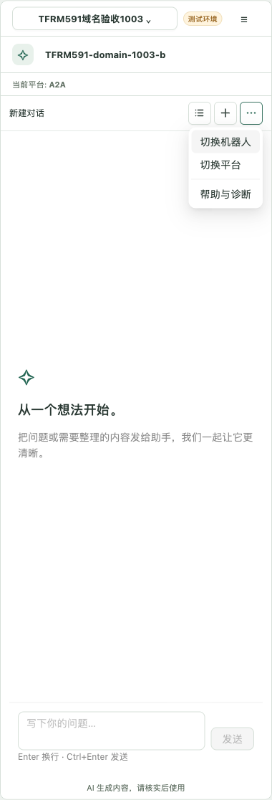
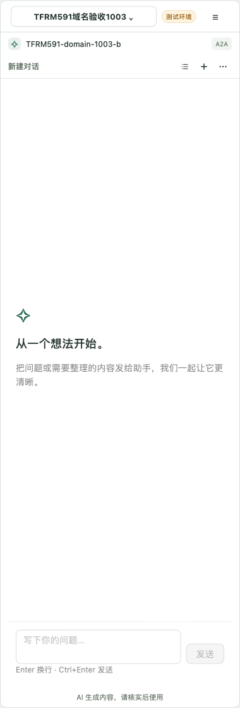
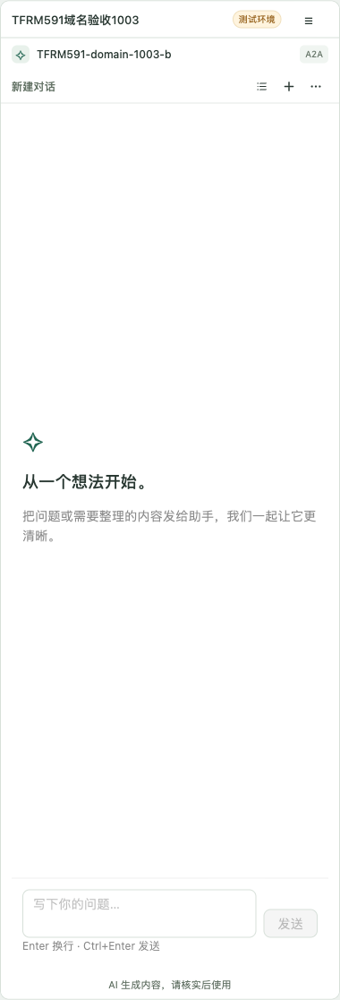

# #135：紧凑聊天工具栏与 test 创建会话契约

日期：2026-10-15。基线：`v0.10.0-next.2`（`5b162fec8466`）。

## 本轮需求与范围

用户在真实 test 预览后要求：聊天页组织入口移除“当前工作组织”标签；历史、新建改为图标；三点点击展开功能菜单；机器人和会话平台仅展示当前值，切换收进菜单；核实是否必须填写会话名。

范围为 IN，落在 `chat-kit/manager-antd` 默认组合界面和 `chat-ui-antd` 紧凑工具栏，遵循 ADR-009/010/014/015。通用 UI 的可选 `moreActions` 仅承载标签、可用性和回调，不依赖 Manager 或宿主业务。宿主继续拥有认证、服务地址、平台预设和实例释放。没有更改 Gateway、Runtime、认证或 Server 创建契约，没有修改 Word 项目。

## 首轮交互结果

- 组织仍是带边框与展开标记的按钮，保留无障碍名称；设置页保留完整组织标签和身份说明。
- 机器人、平台为只读摘要。历史、新建使用有提示、焦点和无障碍名称的 SVG 图标按钮，图标复用既有紧凑导航绘制。
- 三点先向下展开菜单，包含切换机器人、切换平台、帮助与诊断。只有选中功能才进入对应界面，保留原有草稿、切换确认和实例隔离规则。宿主固定或不支持选择的平台不能通过菜单切换。
- Esc 关闭菜单并将焦点还给三点按钮；从选择或诊断界面返回也回到常驻触发按钮。
- 点击新建不会立即创建空会话，也不要求填写名称。首次发送沿用消息前 60 字符作为创建请求标题。

真实 test 集群截图（380px）：



## Server 核验

从 CNB fetch 最新 `TFRobotServer origin/develop`，提交为 `821cdf8f7fd2403177508d54e9dfab61c22bae15`。`ConversationPostDto` 的 `title: str = Field(...)` 和 `platformId` 均必填；创建路由使用 JSON body。这不是本地未提交的 Server 改动。

另通过真实 Manager 用户登录、组织选择及 RFC 8693 机器人 session 交换，直接请求 test 的机器人 B：

```text
POST https://tfrm642-1010-g.test.turingfocus.cn/c/tfrobot/de-b79e1550a96a4a6b9294/v1/chat/conversations
Content-Type: application/json
Authorization: Bearer <仅内存使用，未记录>

{"platformId":1}

HTTP 422
detail: [{"loc":["body","title"],"type":"missing","msg":"Field required"}]
```

平台 1 为用户指定的 A2A。探针没有创建会话，无需清理。结论是用户无需填写名称，但当前 test Server 的请求仍须包含 `title`；保留从首条消息生成标题的现有实现。

## 验证

- `CHANGESET_BASE_REF=origin/develop pnpm check` 中 workspace、Changesets、依赖边界、lint、格式、类型、构建及全量 85 文件／1531 项测试通过。首轮产物验证受本地并发重打包清理影响，未把该次命令算为整条成功；停止并发重打包后，最终 `pnpm pack:check` 单独重跑通过，包含八包、ATTW 和独立消费者安装/编译/运行。
- 最终打包后的独立 HTTPS Chromium/WebKit 消费者 **32/32 通过**（52.3 秒）。包含新增菜单、四种宽度、键盘焦点、只读摘要、固定平台，以及原有登录/切换/历史/首发/回复/退出链路；创建请求断言明确验证由首条消息提供 `title`，没有名称输入步骤。
- 最终格式、类型与 StrictMode DOM 回归 2/2 通过。全范围隔离审查结论为 APPROVE，阻塞项 0；完整 ArrowDown／Enter 菜单选择测试是后续非阻塞补强建议。
- 真实 test 登录、组织/机器人/平台选择、菜单显示、机器人和平台候选浏览后返回、Esc 关闭和焦点回返、省略标题的 422 契约探针已执行。取消浏览后仍为机器人 B／A2A。本轮不将受控服务浏览器结果等同于完整真实 Word UAT。

首轮验证时仅保留本地实现，未提交、推送或发布；原始用户工作区保持不变。预览临时宿主位于构建清理目录之外，地址为 `http://localhost:4311`。

## 后续反馈：压缩上下文展示

用户进一步反馈：“这里的机器人名，平台，会话名展示的不太好看 而且占用空间比较多，那三个按钮也比较大 修改一下”。

将机器人和平台合并为一行：20px 标记、12px 机器人名称和平台小标签；会话标题和操作按钮共用下一行。去掉机器人与平台之间的独立行和分隔线。真实 test 380px 预览测得两行分别 36px、37px，合计 73px（不含组织栏）。历史、新建、更多改为 28px 轻量按钮和 14px 图标，保留悬停、可见焦点及无障碍名称。图标默认尺寸仍为 16px，旧独立 Shell 不受影响。

长机器人、平台和会话名称不再撑高标题区，采用省略显示与完整名称提示；设置、选择页仍展示完整上下文，固定平台／不支持选择的状态仍可查看。添加四种宽度下的高度、尺寸、无横向溢出及长名称提示断言。此调整未改变业务契约或聊天生命周期。



本轮 `pnpm pack:workspace`、格式、eslint、typecheck 和 Changesets coverage 通过。定向 UI／StrictMode DOM **19/19** 通过，最新本地 tarball HTTPS Chromium/WebKit **32/32** 通过（51.3 秒），覆盖四种宽度下的 28px 按钮、14px 图标、两行高度上限 76px、无横向溢出，以及机器人／平台／会话的完整名称提示。未重复首轮的 1531 项全量与完整产物检查；本轮截图和实际 73px 测量来自真实 test，浏览器回归来自受控服务。

本轮完整隔离审查结论为 **APPROVE，阻塞项 0**。纯键盘菜单选择测试和“更多”图标的同款悬停提示为非阻塞补强建议；上节验证与审查结果属于首轮菜单调整。

## 后续反馈：组织名称只读

用户对顶部组织按钮补充：“这里也纯展示 不点击了，功能其实由右侧设置能代替”。此项明确替代首轮的顶部组织可点击要求。

顶部组织改为只读名称，移除边框、箭头、加载状态和点击处理；组织切换仍由右侧账号设置页的原有操作完成。名称单行省略，并通过完整名称提示与无障碍分组保留身份信息；设置页与组织候选列表仍展示完整名称。顶部栏默认约 41px，长名称不撑高；机器人／平台和会话两行保持 73px。

新增只读点击不导航、无组织切换按钮／箭头、四种宽度与超长组织名下顶部高度上限 42px、完整名称提示、从右侧设置进入组织选择并取消返回的验证。未改变身份、候选取消、草稿、连接或 Server 契约。



最新构建、八包打包、类型、格式、eslint 和 Changesets coverage 通过；定向 UI／StrictMode DOM **19/19** 通过，最新本地 tarball HTTPS Chromium/WebKit **32/32** 通过（51.3 秒）。真实 test 验证顶部只有右侧设置按钮、点击组织名不导航、顶部实测 41px，并从设置进入组织选择后取消返回原聊天，组织保持不变且焦点回设置按钮。未重复前两节的全量门禁；未执行真实 Word 全链 UAT。

本轮完整隔离审查结论为 **APPROVE，阻塞项 0**；纯键盘菜单选择用例仍为非阻塞补强建议。前两节结果保留各自范围。

用户最终确认：“ok 就按这样实施”，随后授权“commit and push”。确认版本为上述只读组织标题、两行紧凑上下文和图标菜单，已落实到默认 `ManagerChatApp`／`ChatCompactWorkspace`。本记录随实现提交至 `fix/135-compact-chat-toolbar` 功能分支；未执行版本发布，真实 Word 全链 UAT 仍待宿主升级后验收。

## next.4 发布整合

用户明确要求 next.4 包含紧凑 UI。整合基线为 main `16aab36909a7fddb81f662fb8540f64f56754221`，同时保留 #141 的服务端消息身份和发送状态；紧凑 UI 源提交为 `6b17735d190e13eff2859f76e4284e8909153cfe`。PR #142 改为面向 main，版本由后续 Changesets PR 生成。

旧 PR 的 WebKit CI 在确认平台切换后读取到原草稿。本地整合产物 34/34 浏览器场景通过，尚未复现产品错误；测试补充取消确认框关闭、候选平台选中、新确认框关闭及新平台上下文生效的可观察状态断言，再检查草稿为空并实际发送。没有删除或放宽草稿隔离断言，也没有加入固定睡眠或失败重试。

针对 #145 中多次 npm 上传成功、但两分钟内公开 Registry 不可见的证据，将单包传播等待上限延长到五分钟；仍在摘要不符时立即失败，保持既有版本核对和跳过逻辑。模拟第三分钟才可见的回归先在旧策略失败，新策略通过，断言每包仅上传一次；发布脚本 20 项测试通过。该调整不重新使用或覆盖 next.3，也不宣称已解释其第五次 CI 缺失日志的失败。

完整质量门、修订后的浏览器检查、next.4 Registry 及最终发布结果随后记录在 PR、相关 Issue 和 GitHub Release；本节不代替真实 Word 验收。

修订同步断言后的独立 tarball HTTPS Chromium/WebKit 再次 **34/34 通过**（54.9 秒），包含确认切换后空草稿、保留取消前草稿并实际发送，以及合入的 #141 消息身份链路。已检查本轮 WebKit 的 380px 紧凑工具栏截图，组织只读、两行上下文及图标按钮均保留。
